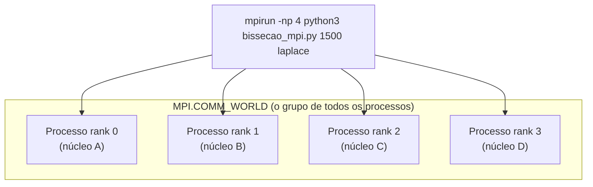
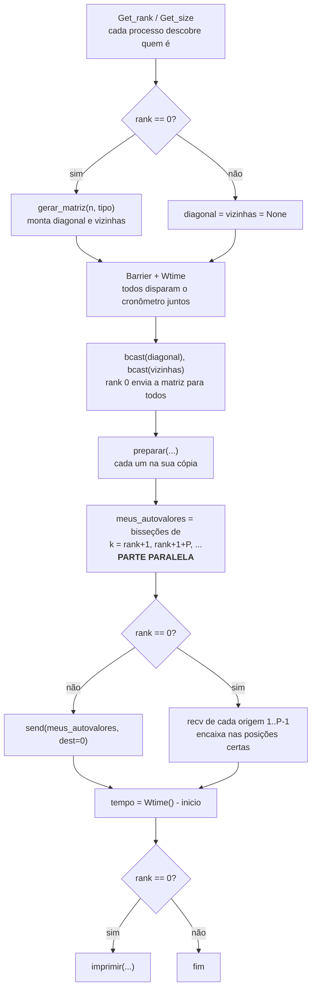
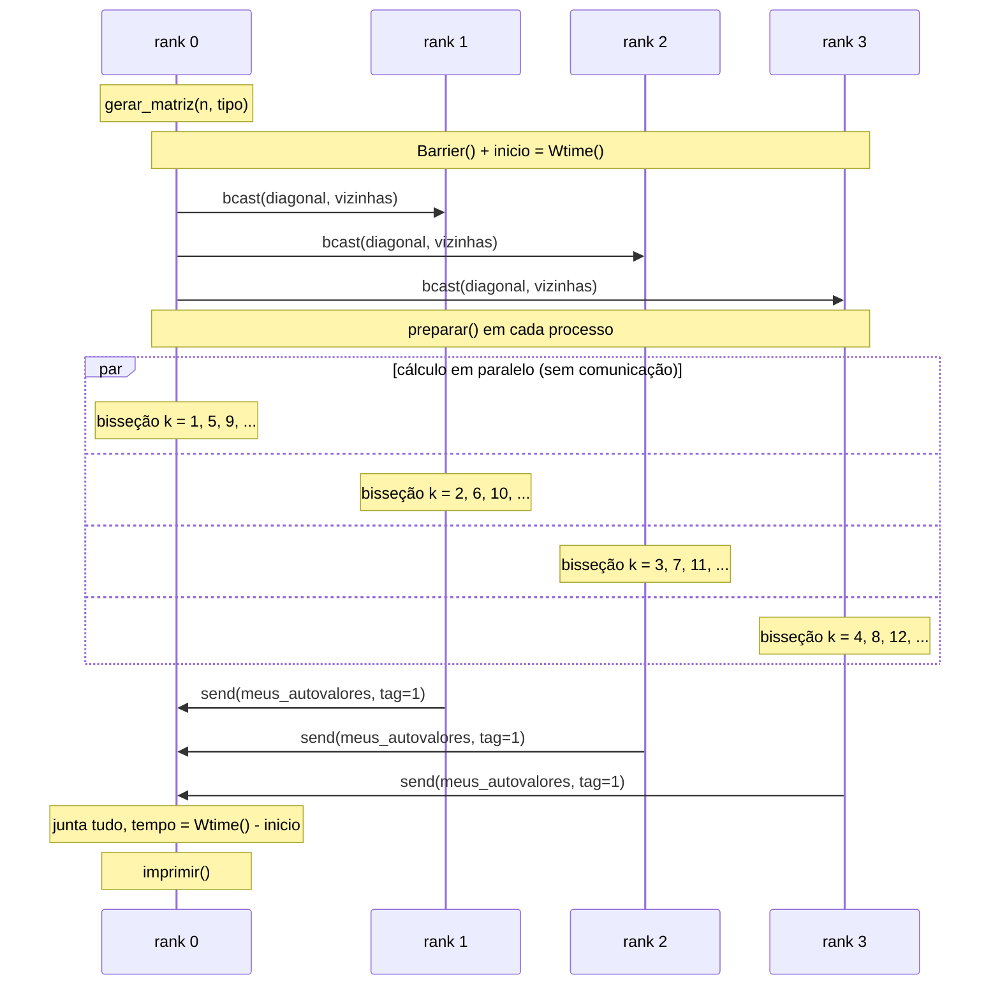
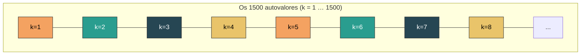
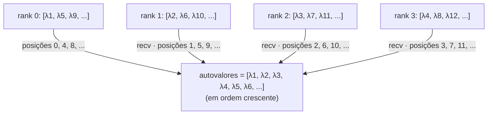

# Como funciona a versão MPI (`python/bissecao_mpi.py`)

Este documento explica o `main()` de [`python/bissecao_mpi.py`](python/bissecao_mpi.py)
(linhas 145–186): o que o MPI faz em cada parte e onde o trabalho é dividido
entre os núcleos.

As funções de cálculo (`gerar_matriz`, `preparar`, `contagem_sturm`,
`bissecao`) são **as mesmas** da versão serial. Só o `main()` muda.

---

## 1. A ideia central: um programa, várias cópias

O MPI **não** pega uma função e "despacha" para um núcleo. Quem cria o
paralelismo é o comando `mpirun`:

```sh
mpirun -np 4 python3 python/bissecao_mpi.py 1500 laplace
```

Esse comando abre **4 processos independentes**, todos rodando **o mesmo
arquivo `.py`, do começo ao fim**. O sistema operacional coloca cada processo
num núcleo. O MPI liga os processos entre si, para que possam trocar
mensagens, e dá a cada um um número, o **rank**.



Esse modelo se chama **SPMD** (*Single Program, Multiple Data*): **um** programa,
executado várias vezes, cada execução sobre uma **parte diferente** dos dados.

Cada processo tem a **sua própria memória**. Nenhum enxerga as variáveis do
outro, e a única forma de passar dados entre eles é por **mensagens** MPI
(`bcast`, `send`, `recv`).

---

## 2. O rank: como cada processo sabe o que fazer

```python
comunicador = MPI.COMM_WORLD             # o grupo com todos os processos
rank = comunicador.Get_rank()            # "quem sou eu?"  → 0, 1, 2 ou 3
num_processos = comunicador.Get_size()   # "quantos somos?" → 4
```

Como o código é igual para todos, **o rank é a única coisa que faz cada
processo agir diferente**:

- `if rank == 0:` são tarefas só do processo "chefe" (montar a entrada,
  juntar os resultados, imprimir);
- `range(rank + 1, n + 1, num_processos)` faz cada processo escolher a sua
  fatia de autovalores.

---

## 3. O `main()` passo a passo



| Linhas | Código | O que o MPI faz | Quem executa |
|---|---|---|---|
| 146–148 | `COMM_WORLD`, `Get_rank`, `Get_size` | cada processo descobre o seu número e o total | todos |
| 152–154 | `if rank == 0: gerar_matriz(...)` | só o rank 0 tem a matriz (como num caso real, lida de um arquivo) | só o 0 |
| 156 | `Barrier()` | **sincronização:** ninguém passa daqui até todos chegarem | todos |
| 157 | `MPI.Wtime()` | relógio do MPI; o tempo começa igual para todos | todos |
| 160–161 | `bcast(diagonal)`, `bcast(vizinhas)` | **comunicação coletiva:** o rank 0 envia, os outros recebem uma cópia | todos |
| 162–163 | `preparar(...)` | cálculo local (cada um na sua cópia, sem comunicação) | todos |
| 168–170 | `meus_autovalores = [...]` | **cálculo paralelo:** cada um faz as suas bisseções, sem conversar | todos, cada um com a sua parte |
| 175 | `send(..., dest=0, tag=1)` | **comunicação ponto a ponto:** envia o resultado ao rank 0 | ranks 1 … P-1 |
| 181–182 | `recv(source=origem, tag=1)` | recebe o resultado de cada processo | só o 0 |
| 183 | `Wtime() - inicio` | para o cronômetro (o tempo inclui a comunicação) | todos |
| 185–186 | `imprimir(...)` | mostra o resultado uma vez só | só o 0 |

---

## 4. A linha do tempo: quem fala com quem

O diagrama abaixo mostra os 4 processos ao longo do tempo. As setas são as
mensagens MPI.



Os processos só se comunicam **duas vezes**: uma para receber a entrada
(`bcast`) e outra para entregar o resultado (`send`/`recv`). Todo o resto do
tempo, cada um calcula sozinho. Por isso o speedup é bom: a maior parte do tempo
é cálculo, não conversa.

---

## 5. Onde o trabalho é dividido

Está nas linhas 168–170:

```python
meus_autovalores = [bissecao(diagonal, vizinhas_ao_quadrado, pivo_minimo,
                             limite_inferior, limite_superior, k)
                    for k in range(rank + 1, n + 1, num_processos)]
```

Todos executam essa mesma linha, mas como o `rank` é diferente, cada um pega
valores de `k` diferentes. Ninguém precisa avisar os outros: cada processo
**deduz sozinho** a sua parte.

Exemplo com `n = 1500` e `P = 4`:

| Processo | `range(...)` | Autovalores calculados | Quantidade |
|---|---|---|---|
| rank 0 | `range(1, 1501, 4)` | k = 1, 5, 9, …, 1497 | 375 |
| rank 1 | `range(2, 1501, 4)` | k = 2, 6, 10, …, 1498 | 375 |
| rank 2 | `range(3, 1501, 4)` | k = 3, 7, 11, …, 1499 | 375 |
| rank 3 | `range(4, 1501, 4)` | k = 4, 8, 12, …, 1500 | 375 |



Cada cor é um processo (laranja = rank 0, verde = rank 1, azul = rank 2,
amarelo = rank 3).

### Por que intercalado (e não em blocos)?

A distribuição poderia ser em blocos (rank 0 com k = 1…375, rank 1 com
k = 376…750 etc.), mas os autovalores **perto de zero** precisam de mais passos
de bisseção que os outros. Em blocos, um processo ficaria com mais trabalho e
os outros esperariam por ele. Intercalando (distribuição **cíclica**), cada
processo recebe uma mistura de autovalores "fáceis" e "difíceis", e a carga
fica equilibrada.

Nos nossos testes, com P = 2, a distribuição em blocos deixava um processo com
4,8 s e o outro com 3,3 s. A cíclica deixou os dois com tempos praticamente
iguais.

### Por que isso pode rodar em paralelo?

A bisseção do autovalor `k` **não depende** da bisseção de nenhum outro
autovalor: cada uma só precisa da matriz e do próprio `k`. A contagem de Sturm,
dentro de cada bisseção, continua sequencial (cada pivô depende do anterior),
mas bisseções diferentes rodam ao mesmo tempo em núcleos diferentes.

O número total de contagens de Sturm **não muda** (com n = 1500, são cerca de
80 mil). O que muda é que elas são feitas **ao mesmo tempo**, divididas entre
os processos.

---

## 6. Como o rank 0 junta os resultados

Cada processo devolve uma lista na ordem do seu `range`. O rank 0 encaixa
cada lista de volta usando o mesmo "passo" (*slice* com salto
`num_processos`):

```python
autovalores = [0.0] * n
autovalores[0::num_processos] = meus_autovalores            # posições 0, 4, 8, ...
for origem in range(1, num_processos):
    autovalores[origem::num_processos] = comunicador.recv(  # posições origem, origem+4, ...
        source=origem, tag=TAG_AUTOVALORES)
```



(A posição `i` da lista guarda o autovalor `k = i + 1`, porque a lista do
Python começa em 0.)

A **tag** (`TAG_AUTOVALORES = 1`) é uma etiqueta na mensagem: o `recv` só
aceita mensagens com a mesma tag do `send`. Aqui só existe um tipo de
mensagem, mas a tag mostra o padrão usado nas aulas (`MPI_Send` /
`MPI_Recv` com `tag`).

---

## 7. Equivalência com o MPI em C (das aulas)

| Python (mpi4py) | C (MPI) | Para quê |
|---|---|---|
| `MPI.COMM_WORLD` | `MPI_COMM_WORLD` | o grupo de todos os processos |
| `comunicador.Get_rank()` | `MPI_Comm_rank(MPI_COMM_WORLD, &rank)` | número deste processo |
| `comunicador.Get_size()` | `MPI_Comm_size(MPI_COMM_WORLD, &size)` | total de processos |
| `comunicador.Barrier()` | `MPI_Barrier(MPI_COMM_WORLD)` | espera todos chegarem |
| `MPI.Wtime()` | `MPI_Wtime()` | relógio em segundos |
| `comunicador.bcast(x, root=0)` | `MPI_Bcast(x, n, MPI_DOUBLE, 0, MPI_COMM_WORLD)` | um envia para todos |
| `comunicador.send(x, dest=0, tag=1)` | `MPI_Send(x, n, MPI_DOUBLE, 0, 1, MPI_COMM_WORLD)` | envia para um processo |
| `comunicador.recv(source=i, tag=1)` | `MPI_Recv(x, n, MPI_DOUBLE, i, 1, MPI_COMM_WORLD, &status)` | recebe de um processo |
| *(automático no `import`)* | `MPI_Init` / `MPI_Finalize` | iniciar e encerrar o MPI |

No mpi4py, os métodos em **minúsculas** (`bcast`, `send`, `recv`) aceitam
qualquer objeto Python (listas, por exemplo) e cuidam sozinhos do tamanho e do
tipo. Por isso não aparecem o `n` nem o `MPI_DOUBLE` que o C exige.

---

## 8. Resumo

1. **`mpirun -np P`** cria P cópias do programa, e o sistema operacional põe cada uma num núcleo.
2. **O rank** diz a cada cópia quem ela é.
3. **O rank 0** monta a matriz e a distribui com **`bcast`**.
4. Cada processo calcula **sozinho** os autovalores `k = rank+1, rank+1+P, …`. Essa é a parte paralela.
5. Os outros processos devolvem os resultados ao rank 0 com **`send`**, e o rank 0 os recebe com **`recv`**.
6. O rank 0 junta tudo e imprime.

Resultado medido (n = 1500, matriz `laplace`): de **8,00 s** (Python serial)
para **2,20 s** com 4 processos (speedup 3,6) e **1,04 s** com 12 processos
(speedup 7,7).
